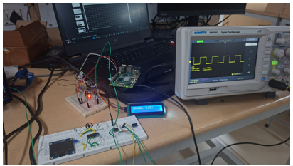
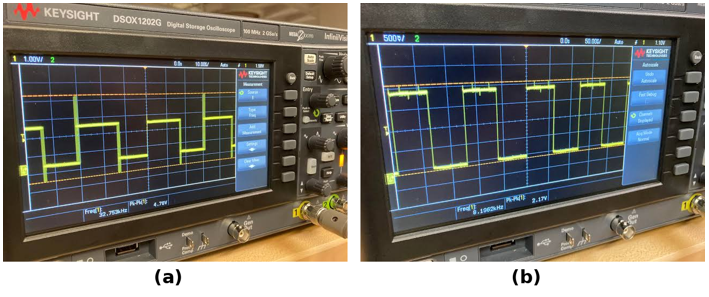

# reflectometry on rpi

real-time telemetry pipeline connecting an analog test circuit, stm32f303k8 microcontroller, and a raspberry pi over uart, with a live web dashboard hosted on the pi.

## how the data flows

1. **analog circuit to stm32**:
   - timer 7 pulses the test line with a fast edge (10 khz).
   - adc1 (pa0) samples line voltage and reflection amplitude.
   - stm32 evaluates line condition (healthy, open, short), calculates fault distance and time delay, and prints status on the 16x2 i2c lcd.

2. **stm32 to raspberry pi**:
   - stm32 streams telemetry frames over usart2 (pa2 tx, 115200 8N1) through the st-link usb interface directly into the raspberry pi (`/dev/ttyACM0`).
   - frame format:
     ```text
     V:1.88,T:0.0,D:0.0,STATUS:HEALTHY
     ```

3. **raspberry pi to web dashboard**:
   - python server on the pi reads serial packets continuously.
   - hosts a real-time web interface on port 5000 with a canvas oscilloscope showing pulse reflections, live voltage, and fault diagnostics.

## pinout and wiring

| nucleo pin | stm32 pin | function | notes |
|---|---|---|---|
| A0 | PA0 | ADC1 input | line sense / reflection input |
| A1 | PA1 | pulse out | fast tdr pulse |
| PF0 (D7) | PF0 | pulse out | test line excitation |
| PB3 (D13) | PB3 | onboard led | pulses with timer 7 |
| A3 | PA4 | DAC1 out | 1 khz sine test signal |
| D5 | PB6 | I2C1 SCL | 16x2 LCD (addr 0x27) |
| D4 | PB7 | I2C1 SDA | 16x2 LCD (addr 0x27) |
| A7 / USB | PA2 | USART2 TX | uart telemetry to rpi at 115200 |
| 5V / GND | power | lcd power and common ground |

## line fault conditions

- **healthy**: voltage ~1.85v, load termination absorbs the pulse
- **open circuit**: voltage > 3.8v, positive reflection echo, estimates fault location (0 to 16 cm)
- **short circuit**: voltage < 0.2v, inverted reflection echo, estimates fault location (0 to 16 cm)

## flashing the stm32

build and flash firmware from windows:
```cmd
build.cmd
```

or build with make:
```powershell
powershell -ExecutionPolicy Bypass -File scripts/build.ps1
powershell -ExecutionPolicy Bypass -File scripts/flash.ps1
```

## running on raspberry pi over ssh

1. ssh into your raspberry pi from your computer:
   ```bash
   ssh chip@chip.local
   ```

2. navigate to the dashboard directory and run the launcher:
   ```bash
   cd dashboard
   chmod +x start.sh
   ./start.sh
   ```

3. open the live dashboard from any browser on your local network (laptop, phone, tablet):
   ```text
   http://chip.local:5000
   ```
   *(or use your pi's ip address, e.g. `http://192.168.1.50:5000`)*

## test bench and waveforms

bench setup showing nucleo board, raspberry pi, 16x2 lcd, and test breadboard:



oscilloscope captures:
- **(a)** tdr reflection step off impedance discontinuity / open line
- **(b)** 10 khz fast excitation pulse (~2.5 ns rise time)


